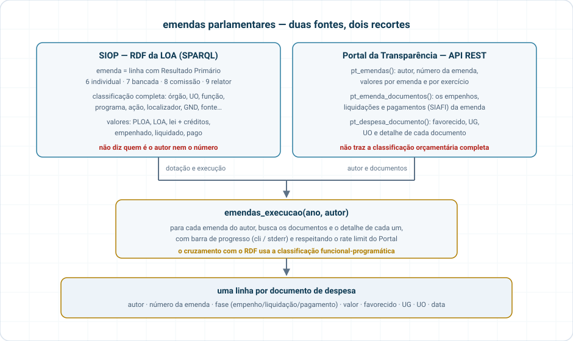
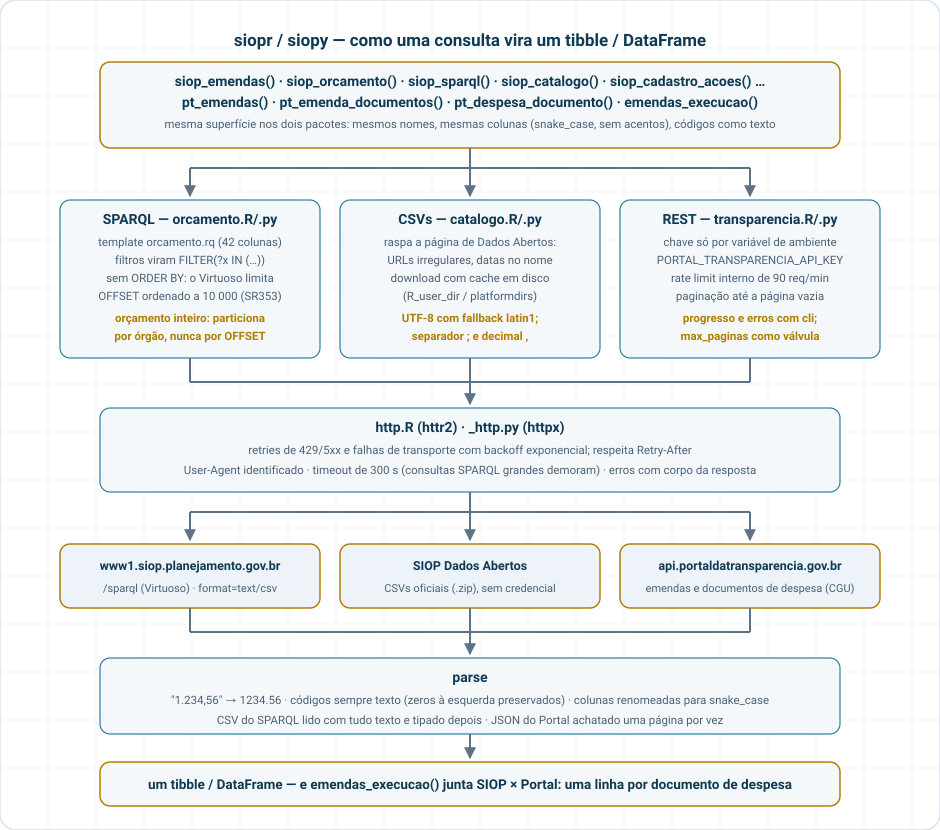

# siop — orçamento federal e emendas parlamentares

<!-- badges: start -->

[](https://github.com/StrategicProjects/siop/actions/workflows/siopr.yaml)
[](https://github.com/StrategicProjects/siop/actions/workflows/siopy.yaml)
[](https://CRAN.R-project.org/package=siopr)
[](https://pypi.org/project/siopy-br/)
<!-- badges: end -->

Pacotes irmãos, com a mesma superfície, para obter **emendas parlamentares e o orçamento
federal** a partir de fontes públicas:

| Prefixo | Fonte | Credencial |
|---|---|---|
| `siop_*` | SIOP Dados Abertos (SOF/MPO): endpoint SPARQL do RDF da LOA + CSVs oficiais | nenhuma |
| `pt_*` | API REST do Portal da Transparência (CGU): emendas por autor, documentos de despesa | chave gratuita (`PORTAL_TRANSPARENCIA_API_KEY`) |

| Pacote | Linguagem | Instalação | Docs |
| --- | --- | --- | --- |
| [`siopr`](siopr/) | R (tibbles, httr2) | CRAN (em preparação): `pak::pak("StrategicProjects/siop/siopr")` | [site](https://strategicprojects.github.io/siop/), [README](siopr/README.md), [NEWS](siopr/NEWS.md) |
| [`siopy`](siopy/) | Python (pandas, httpx) | PyPI: `pip install siopy-br` (o import é `siopy`) | [site](https://strategicprojects.github.io/siop/siopy/), [README](siopy/README.md), [NEWS](siopy/NEWS.md) |

```
siop/
├── siopr/        pacote R   (httr2 + tibble)      — R CMD check --as-cran 0/0/0
├── siopy/        pacote Python (httpx + pandas)   — pytest + ruff (testes live opt-in)
├── fixtures/     amostras reais (SPARQL) e sintéticas (Portal) usadas nos testes
├── schemas/      schemas GraphQL da API autenticada do SIOP (referência futura)
└── DECISIONS.md  decisões de projeto e seus porquês
```

## Superfície (idêntica nos dois pacotes)

| Função | O que devolve |
|---|---|
| `siop_emendas(ano, tipo, ...)` | linhas da LOA com RP 6/7/8/9 (individual/bancada/comissão/relator), classificação completa e valores (ploa, loa, lei+créditos, empenhado, liquidado, pago) |
| `siop_orcamento(ano, ...)` | idem sem filtro de RP; filtros por `orgao`, `uo`, `funcao`, `acao`, `rp`...; particiona por órgão quando sem filtro |
| `siop_sparql(query)` | SPARQL cru → tibble/DataFrame (CSV por padrão) |
| `siop_orgaos(ano)`, `siop_exercicios()`, `siop_ultima_atualizacao()` | metadados do RDF |
| `siop_catalogo()` | tudo que está publicado na página de Dados Abertos (URLs raspadas) |
| `siop_cadastro_acoes(ano, tipo)`, `siop_creditos(ano)`, `siop_acompanhamento(ano)`, `siop_regionalizacao(ano)` | CSVs oficiais com cache em disco |
| `pt_emendas(ano, autor, ...)` | emendas com autor, número, valores (um ou mais autores; acentos normalizados automaticamente) |
| `pt_emenda_documentos(codigos)` | empenhos/liquidações/pagamentos das emendas (um ou mais códigos → um tibble/DataFrame) |
| `pt_despesa_documento(codigos)`, `pt_documentos_relacionados()`, `pt_favorecidos_finais()` | detalhe dos documentos SIAFI (também vetorizadas) |
| `emendas_execucao(ano, autor)` | tudo unido: uma linha por documento com favorecido/UG/UO |
| `camara_deputados(uf)`, `ibge_municipios(uf)`, `cnpj_municipio(cnpj)`, `sem_acento(x)` | apoio, sem chave: deputados (Câmara), municípios com grafia oficial (IBGE), município-sede de CNPJ (Minha Receita) |

## Como as fontes se completam

<p align="center"></p>

## Arquitetura

<p align="center"></p>

## Limitações conhecidas

* O RDF do SIOP não identifica autor nem número de emenda (só RP). Autor vem do Portal.
* O Virtuoso limita `ORDER BY`+`OFFSET` a 10 000 linhas; as consultas do pacote não ordenam e,
  para o orçamento inteiro, particionam por órgão. Consultas com todos os rótulos para um órgão
  grande podem levar dezenas de segundos.
* A API autenticada do SIOP (GraphQL, Conecta gov.br) exige usuário cadastrado por um órgão
  federal — fora do escopo; schemas em `schemas/`.

## Licença

MIT, ver o LICENSE de cada pacote. Dados: SIOP/SOF e Portal da Transparência
(Decreto 8.777/2016).
