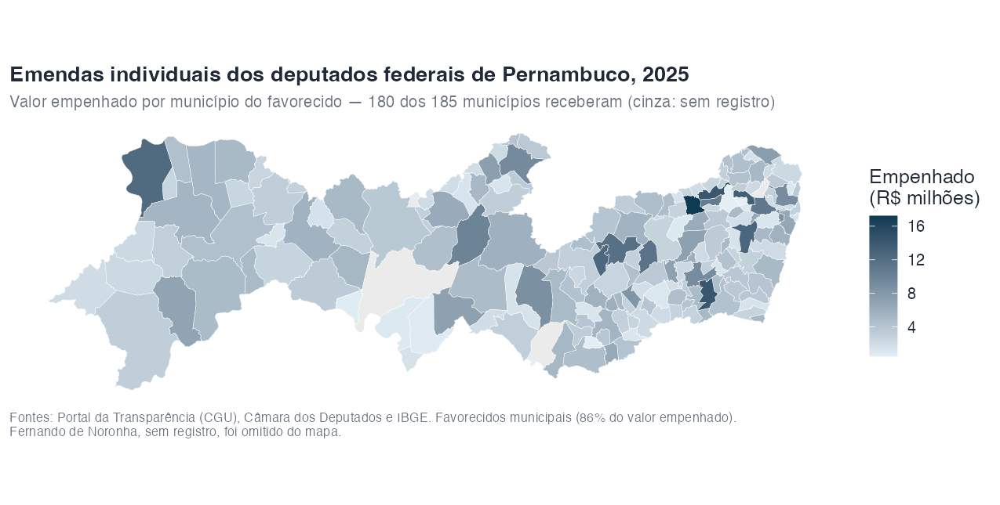
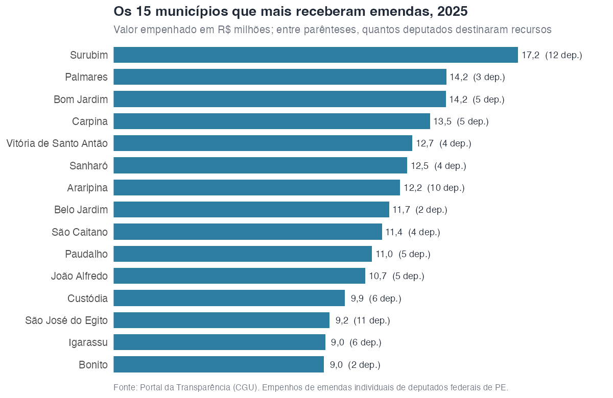

# Em que municípios os deputados de Pernambuco aplicam suas emendas?

Um estudo de caso completo: partir da lista de deputados federais de um
estado e chegar ao mapa dos municípios que recebem suas emendas. Os
trechos de código são reproduzíveis, mas exigem rede e a chave do Portal
da Transparência; as saídas mostradas (e as figuras) foram computadas em
novembro de 2026, sobre o exercício de 2025.

## O problema: a emenda não diz o município

No Portal da Transparência, a emenda tem um campo de localidade — mas
ele quase nunca desce ao município:

``` r

library(siopr)
em <- pt_emendas(2025, autor = "PEDRO CAMPOS")
table(em$localidade_gasto)
#>        MÚLTIPLO        Nacional PERNAMBUCO (UF)     RECIFE - PE
#>               3               1              12               1
```

O destino de verdade aparece na **execução**: cada emenda tem documentos
SIAFI
([`pt_emenda_documentos()`](https://strategicprojects.github.io/siop/reference/pt_emenda_documentos.md)),
e o detalhe de cada empenho
([`pt_despesa_documento()`](https://strategicprojects.github.io/siop/reference/pt_despesa_documento.md))
traz o favorecido — que, nas transferências a municípios, é a prefeitura
ou o fundo municipal.

## Passo 1: os deputados, na API da Câmara

A API de Dados Abertos da Câmara lista os 25 deputados federais em
exercício por PE. Um cuidado: a busca textual do Portal não encontra
nomes acentuados, então consultaremos sempre a forma sem acentos, em
maiúsculas.

``` r

dep <- httr2::request("https://dadosabertos.camara.leg.br/api/v2/deputados") |>
  httr2::req_url_query(siglaUf = "PE", ordem = "ASC", ordenarPor = "nome") |>
  httr2::req_perform() |>
  httr2::resp_body_json()
nomes <- vapply(dep$dados, `[[`, "", "nome")
length(nomes)
#> [1] 25
```

## Passo 2: as emendas de cada um

``` r

sem_acento <- function(x) {
  # no Linux, iconv(x, to = "ASCII//TRANSLIT") resolve; no macOS o TRANSLIT
  # gera marcas ("ANDR'E"), então troque os acentos explicitamente
  toupper(chartr("áàâãéêíóôõúç", "aaaaeeiooouc", tolower(x)))
}

emendas <- lapply(nomes, function(nome) {
  em <- pt_emendas(2025, autor = sem_acento(nome))
  em <- em[em$autor == sem_acento(nome), ]  # a busca da API é textual
  if (nrow(em)) em$deputado <- nome
  em
})
emendas <- do.call(rbind, emendas)
nrow(emendas)
#> [1] 235
```

Dos 25, apenas Silvio Costa Filho (licenciado, hoje ministro) não tem
emendas em 2025. E um bom teste de sanidade: o valor empenhado por autor
encosta no teto individual do exercício, R\$ 37,3 milhões por deputado.

## Passo 3: documento a documento

Dois níveis de consulta: os documentos de cada emenda e o detalhe de
cada empenho. São ~2 mil requisições; o pacote respeita sozinho o limite
de 90 por minuto do Portal, então a célula abaixo leva cerca de meia
hora.

``` r

docs <- do.call(rbind, lapply(emendas$codigo_emenda, pt_emenda_documentos))
empenhos <- unique(docs$codigo_documento[docs$fase == "Empenho"])
detalhe <- do.call(rbind, lapply(empenhos, pt_despesa_documento))
c(documentos = nrow(docs), empenhos = length(empenhos))
#> documentos   empenhos
#>       6411       1854
sum(detalhe$valor)
#> [1] 888278738
```

## Passo 4: do favorecido ao município

Três situações, em ordem de volume:

1.  **O nome do favorecido já diz o município** (“MUNICIPIO DO BOM
    JARDIM”, “FUNDO MUNICIPAL DE SAUDE DE SAO JOSE DO EGITO”): basta
    casar com a lista oficial de municípios de PE do IBGE — do nome mais
    longo para o mais curto, para “São José do Egito” não virar “Egito”.
2.  **O nome é genérico** (“FUNDO MUNICIPAL DE SAUDE”, sem cidade — R\$
    264 milhões!): o CNPJ resolve; a API pública Minha Receita devolve o
    município da sede.
3.  **O favorecido não é municipal**: fornecedores (compras
    centralizadas de máquinas e equipamentos pelos ministérios), o
    estado e seus fundos, universidades. Ficam de fora do mapa — o CNPJ
    de um fornecedor de São Paulo não diz onde o trator vai trabalhar.

``` r

mun_pe <- httr2::request(
  "https://servicodados.ibge.gov.br/api/v1/localidades/estados/PE/municipios"
) |>
  httr2::req_perform() |>
  httr2::resp_body_json() |>
  vapply(`[[`, "", "nome")

municipal <- grepl("^MUNICIPIO|^PREFEITURA|FUNDO MUNICIPAL|CAMARA MUNICIPAL",
                   detalhe$nome_favorecido)
ordem <- order(nchar(mun_pe), decreasing = TRUE)
casa_municipio <- function(s) {
  for (i in ordem) {
    if (grepl(paste0("\\b", sem_acento(mun_pe[[i]]), "\\b"), s)) {
      return(mun_pe[[i]])
    }
  }
  NA_character_
}
detalhe$municipio <- NA_character_
detalhe$municipio[municipal] <-
  vapply(sem_acento(detalhe$nome_favorecido[municipal]), casa_municipio, "")

# os genericos, pelo CNPJ da sede (Minha Receita)
pendentes <- unique(detalhe$codigo_favorecido[municipal & is.na(detalhe$municipio)])
sede <- vapply(pendentes, function(cnpj) {
  httr2::request(paste0("https://minhareceita.org/", gsub("\\D", "", cnpj))) |>
    httr2::req_perform() |>
    httr2::resp_body_json() |>
    getElement("municipio")
}, "")
```

O resultado: **86% do valor empenhado** tem município identificado (2%
vai ao governo do estado, 12% a fornecedores e outras entidades) — e
**nenhum centavo municipal sai de Pernambuco**. Os favorecidos de outras
UFs que aparecem na base são fornecedores e órgãos federais, nunca
prefeituras.

## O mapa

``` r

library(ggplot2)
agregado <- dplyr::summarise(
  detalhe[!is.na(detalhe$municipio), ],
  valor = sum(valor),
  .by = municipio
)
pe <- geobr::read_municipality(code_muni = "PE", year = 2024)
mapa <- merge(pe, agregado, by.x = "name_muni", by.y = "municipio", all.x = TRUE)
ggplot(mapa) +
  geom_sf(aes(fill = valor / 1e6), color = "white", linewidth = 0.1) +
  scale_fill_gradient(low = "#e3eef5", high = "#0e3a53", na.value = "grey92")
```



As emendas individuais chegam a quase todo lugar: **180 dos 185
municípios** receberam algum empenho em 2025 (ficaram de fora Águas
Belas, Fernando de Noronha, Floresta, Santa Cruz da Baixa Verde e
Tracunhaém). E chegam pulverizadas: os 10 municípios que mais recebem
somam só 17% do valor, e é preciso somar 49 municípios para alcançar
metade dele.



Surubim e São José do Egito ilustram dois padrões opostos de destaque:
Surubim lidera recebendo de **12 deputados diferentes**, enquanto Belo
Jardim e Bonito aparecem no topo com recursos de apenas 2. No sentido
inverso, o grau de pulverização varia muito por deputado: de 46
municípios atendidos (Carlos Veras) a 10 (Fernando Coelho Filho), com a
maioria entre 15 e 30.

## Ressalvas

- **Empenho não é pagamento.** Usamos a fase de empenho por ser a mais
  completa no exercício corrente; os valores pagos são menores e chegam
  depois (muitos como restos a pagar).
- **O favorecido municipal indica o destino; o fornecedor, não.** Os 12%
  de “outros” incluem compras centralizadas cujo beneficiário final é um
  município que a base não revela — a cobertura de 86% é um piso, não um
  retrato exato.
- **Transferências especiais** (as “emendas Pix”) têm o município como
  favorecido direto do empenho, então entram no mapa com precisão total.
