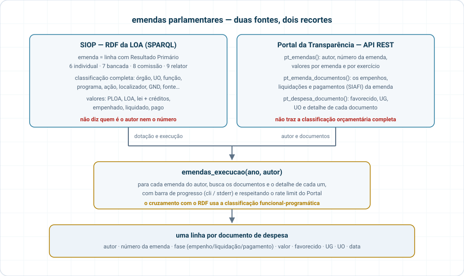
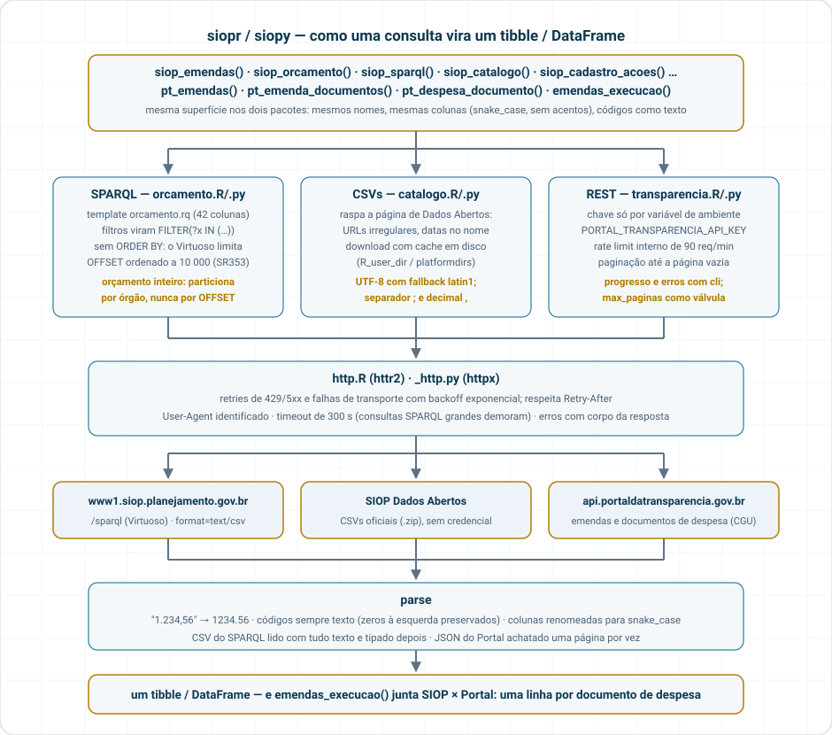

# siopr

Orçamento Federal e emendas parlamentares em tibbles, a partir de
**fontes públicas** (sem credencial do SIOP):

- **SIOP Dados Abertos** (SOF/MPO) — endpoint SPARQL do RDF da LOA
  (2001–2026, com execução) e CSVs oficiais (cadastro de ações,
  créditos, acompanhamento físico, regionalização).
- **Portal da Transparência** (CGU) — API REST de emendas (autor,
  número, valores) e documentos de despesa (empenhos, pagamentos,
  favorecidos). Chave gratuita:
  <https://portaldatransparencia.gov.br/api-de-dados/cadastrar-email>.

Pacote irmão em Python:
[`siopy`](https://strategicprojects.github.io/siopy). Documentação:
<https://strategicprojects.github.io/siop/>.

## Instalação

``` r

# quando publicado no CRAN
install.packages("siopr")

# versão de desenvolvimento
# install.packages("pak")
pak::pak("StrategicProjects/siop/siopr")
```

## Uso

``` r

library(siopr)

# Emendas na LOA 2025 (RP 6 = individuais, 7 = bancada, 8 = comissão, 9 = relator)
em <- siop_emendas(2025, tipo = c("individual", "bancada"))
dplyr::summarise(em, dplyr::across(c(loa, empenhado, pago), sum), .by = tipo_emenda)

# Só o Ministério da Saúde, função 10
siop_emendas(2025, tipo = "individual", orgao = "36000", funcao = "10")

# Orçamento inteiro de um órgão (qualquer RP)
siop_orcamento(2025, orgao = "26000")

# Última carga do RDF
siop_ultima_atualizacao()

# SPARQL cru
siop_sparql("SELECT ?exercicio ?d WHERE { GRAPH ?g { ?e a loa:Exercicio ;
  loa:identificador ?exercicio ; loa:dataUltimaAtualizacao ?d } }")

# CSVs oficiais (cache em disco; refresh = TRUE para rebaixar)
siop_cadastro_acoes(2025, "localizadores")
siop_creditos(2025)
siop_catalogo()

# Portal da Transparência — Sys.setenv(PORTAL_TRANSPARENCIA_API_KEY = "...")
pt   <- pt_emendas(2025, autor = "NOME DO PARLAMENTAR")
docs <- pt_emenda_documentos(pt$codigo_emenda[[1]])
det  <- pt_despesa_documento(docs$codigo_documento[[1]])

# Tudo junto: uma linha por documento, com favorecido/UG/UO
emendas_execucao(2025, autor = "NOME DO PARLAMENTAR")
```

Colunas em `snake_case`, códigos como texto (zeros à esquerda
preservados), valores em R\$ numéricos. O RDF do SIOP **não** traz autor
nem número de emenda — isso vem do Portal da Transparência:



## Arquitetura



## Atualização das fontes

| Fonte | Periodicidade | Como verificar |
|----|----|----|
| RDF/SPARQL SIOP | recarga a cada poucos dias (exercício corrente); anteriores reprocessados periodicamente | [`siop_ultima_atualizacao()`](https://strategicprojects.github.io/siop/reference/siop_exercicios.md) |
| CSVs SIOP | publicações pontuais (data no nome do arquivo) | [`siop_catalogo()`](https://strategicprojects.github.io/siop/reference/siop_catalogo.md) |
| PT – Tesouro Gerencial (emendas, despesas) | diária | página *Origem dos Dados* |
| PT – Apoios/Solicitações (SLCN) | semanal | idem |

## Testes

``` r

devtools::test()                               # offline, com fixtures
Sys.setenv(SIOPR_LIVE = "true"); devtools::test()  # inclui chamadas reais
```
