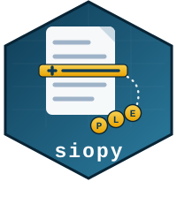
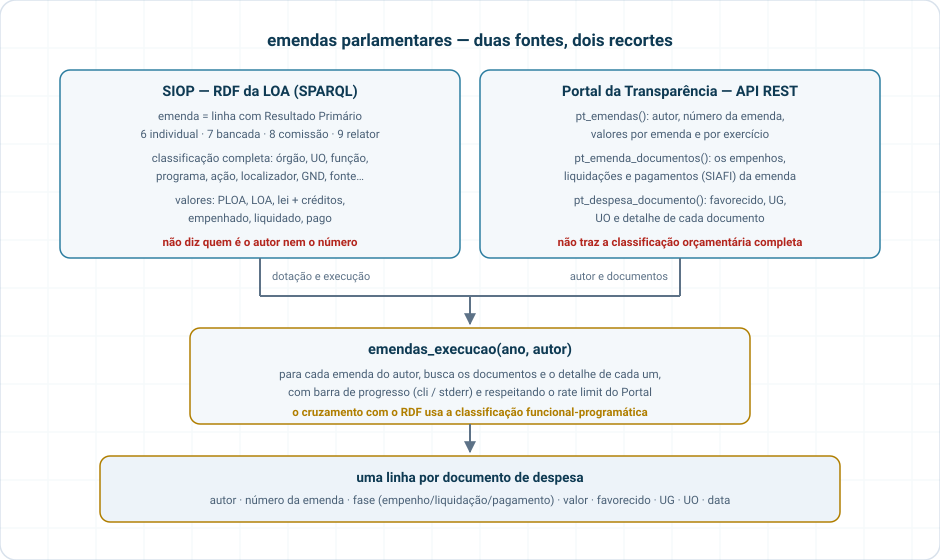
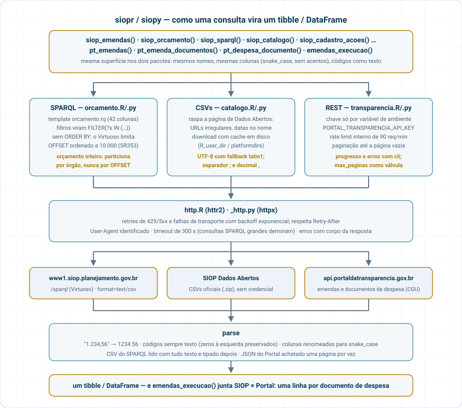

# siopy 

<!-- badges: start -->


[](https://github.com/StrategicProjects/siop/actions/workflows/siopy.yaml)
[](https://pypi.org/project/siopy/)
<!-- badges: end -->

Orçamento Federal e emendas parlamentares em `pandas`, a partir de **fontes públicas**:

* **SIOP Dados Abertos** (SOF/MPO) — endpoint SPARQL do RDF da LOA (2001–2026, com execução:
  PLOA, LOA, lei + créditos, empenhado, liquidado, pago) e CSVs oficiais (cadastro de ações,
  créditos, acompanhamento físico, regionalização). Sem credencial.
* **Portal da Transparência** (CGU) — API REST de emendas parlamentares (autor, número,
  valores por emenda) e documentos de despesa (empenhos, pagamentos, favorecidos).
  Requer chave gratuita: <https://portaldatransparencia.gov.br/api-de-dados/cadastrar-email>.

Pacote irmão em R: [`siopr`](https://github.com/StrategicProjects/siop/tree/main/siopr).
Documentação: <https://strategicprojects.github.io/siop/siopy/> (site do monorepo:
<https://strategicprojects.github.io/siop/>).

## Instalação

```bash
pip install siopy            # quando publicado no PyPI
pip install -e ".[dev]"      # desenvolvimento, a partir deste diretório
```

## Uso

```python
import siopy

# Emendas na LOA 2025 (RP 6 = individuais, 7 = bancada, 8 = comissão, 9 = relator)
em = siopy.siop_emendas(2025, tipo=["individual", "bancada"])
em.groupby("tipo_emenda")[["loa", "empenhado", "pago"]].sum()

# Só o Ministério da Saúde, função 10
siopy.siop_emendas(2025, tipo="individual", orgao="36000", funcao="10")

# Orçamento inteiro de um órgão (qualquer RP)
siopy.siop_orcamento(2025, orgao="26000")

# Quando foi a última carga do RDF?
siopy.siop_ultima_atualizacao()

# SPARQL cru (CSV por padrão; o Virtuoso limita ORDER BY+OFFSET a 10k linhas)
siopy.siop_sparql("PREFIX loa: <http://vocab.e.gov.br/2013/09/loa#> SELECT ... ")

# CSVs oficiais (cache em disco; refresh=True para baixar de novo)
siopy.siop_cadastro_acoes(2025, "localizadores")
siopy.siop_creditos(2025)
siopy.siop_catalogo()  # tudo que está publicado na página de Dados Abertos

# Portal da Transparência — export PORTAL_TRANSPARENCIA_API_KEY=...
pt = siopy.pt_emendas(2025, autor="NOME DO PARLAMENTAR")
docs = siopy.pt_emenda_documentos(pt.loc[0, "codigo_emenda"])
det = siopy.pt_despesa_documento(docs.loc[0, "codigo_documento"])

# Tudo junto: 1 linha por documento, com favorecido/UG/UO
siopy.emendas_execucao(2025, autor="NOME DO PARLAMENTAR")
```

Colunas em `snake_case`, códigos como texto (zeros à esquerda preservados), valores em R$ como
`float`. O RDF do SIOP **não** traz autor nem número de emenda — isso vem do Portal da
Transparência:

<p align="center"></p>

## Arquitetura

<p align="center"></p>

## Atualização das fontes

| Fonte | Periodicidade | Como verificar |
|---|---|---|
| RDF/SPARQL SIOP | recarga a cada poucos dias (exercício corrente) e reprocessamento periódico dos anteriores | `siop_ultima_atualizacao()` |
| CSVs SIOP | publicações pontuais (data no nome do arquivo) | `siop_catalogo()` |
| PT – Tesouro Gerencial (emendas, despesas) | diária | página *Origem dos Dados* do portal |
| PT – Apoios/Solicitações (SLCN) | semanal | idem |

## Testes

```bash
pytest                 # offline, com fixtures
SIOPY_LIVE=true pytest # inclui chamadas reais (precisa de rede e da chave para pt_*)
```

## Licença

MIT. Dados: SIOP/SOF (CC BY-NC 4.0 para a documentação; dados abertos) e Portal da
Transparência (Decreto 8.777/2016).
